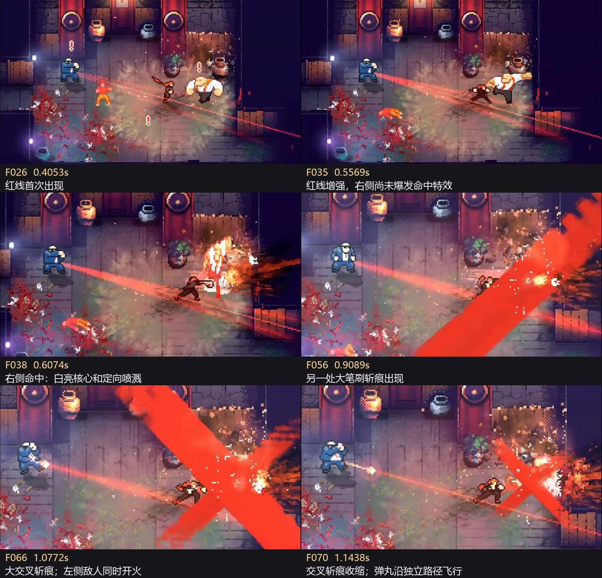

# COMBAT-FEEL-005｜敌人蓄力红线与受击特效复刻任务书

日期：2026-11-04。编写：5MinMore 游戏顾问。

**当前最新：用户要求红线和扇形最远不超过射程，进入 [R10 射程封顶](enemy-charge-fan-rework-20261104.md)。** 中心、填充、柔光与余线均取真实武器射程和合法遮挡的先到者，目标只确定方向；不改战斗数值与0.5秒。下方R9“延墙”只能在射程内成立。

**最新用户退回：红线视觉验收撤回，进入 [R9 延墙像素核心／发光边线／半透明扇形返工](enemy-charge-fan-rework-20261104.md)。** R8 仍错误地缩短到角色附近且缺少边缘柔光。中心像素实线全程存在并延伸至墙，发光两侧与半透明填充向核心收束后真实发弹；目标仅确定方向。R7双尖轮廓和旧八段宽度曲线不再作为正确目标。本轮只交美术修红线，保留0.5秒前摇、R7余线计时和受击候选；新书优先。

**当前阶段：用户已明确授权美术现在开始实装，不等待优化结束。** 唯一负责人为 5MinMore 美术 `01a19cc7-d32b-7081-97e2-4b72cdd0c8b3`。美术做红线及受击特效，优化继续查卡顿；沿用同一主小样，不接入正式游戏，最后由顾问统一验收汇报。此前“只读准备”“后续明确启动后”均已被本次授权替代；不能据旧阶段限制停工。

### 2026-11-04 用户确认与测量落地

- 用户已明确选择：**保留 0.5 秒，复刻视觉**。真实战斗继续使用现有 0.5 秒前摇及末段锁定规则；参考可见 0.67190 秒的造型与变化曲线按权威进度映射，不能延长前摇，也不能声称绝对秒数相同。
- 顾问直接核对主小样 `scripts/entities/employee_enemy.gd:2015`：实际入口为 `_begin_ranged_attack_windup()`，OTXO 分支为 `.5`；剩余大于 `.12` 时继续更新目标快照。非 OTXO 分支沿用原有配置，不纳入此次数值修改。
- 测量依据为 [美术测量报告](../../.runtime/enemy_feedback_video_20261104/art_review/REPORT.md) 和同目录原始数据。已抽查 F026 红线与 F038 命中分区。报告中的透明度数值是合成后色度代理，不是真实源 alpha；后续必须在实际 Camera 下拟合。
- 红线沿轴分为细亮线与宽半透明红带，使用 0 / .226 / .301 / .401 / .477 / .725 / .975 / 1 的归一化参考采样；不能把各层统一做成单调增粗。开火后可见残线约 0.10–0.13 秒，另按真实发弹事件驱动，不因映射前摇一并缩放。
- 命中接触点为时间零点：参考接触核约 0.30H×0.36H，局部竖向亮形约 0.70H×0.72H；最亮尖部前两帧最强，约 34 ms 显著衰减，约 68 ms 退出强亮层；主喷溅约 34–118 ms 明显，约 135 ms 开始破碎，碎点随后退出。H 为实际 Camera 下目标身体高度。被遮挡和片段截断的部分仍列未知，不以估计冒充原作参数。
- 红叉及其前置大斜杠完全排除。准备报告的代码入口表述已校正；现在依照下方文件边界与同一小样基线实施，不再请求用户重复选择前摇时长或重复授权开工。

### 已完成的测量准备（历史阶段）

- 读取现有 93 帧及时间戳，完成第 4、5 节要求的红线与受击分层测量，输出可核对的帧号、相对身体尺度、颜色／透明度变化和各层时序。不要重新交一份只有原则的赏析。
- 只读当前统一主小样的展示入口，对照现状给出最小文件变更范围、可复用部分和缺口；不代替顾问另派主工作流或其他聊天。
- 明确区分已观测、无法判断、需试验的内容。若参考约 0.672 秒与当前真实蓄力时长不同，报告实际代码值和可见差异，不能自行决定改战斗节奏或假称已经完全一致。
- 写入只限 `.runtime/enemy_feedback_video_20261104/art_review/` 中的测量、证据与交接报告；不写主小样、正式工程、顾问任务书或其他专项文件，不运行游戏 GPU 验证。
- 准备报告已交顾问并复核；以上只读限制只用于已结束的测量阶段，当前实施范围以第 7 节为准。

**最新用户修正优先于初稿：红叉暂时不需要，只需要特效打击感和红线的完全复刻。** 本书目标改为对视频可见表现进行逐帧复刻；删除红叉及其前置大幅斜向笔刷，不保留为本任务的可选第二阶段。下方出现红叉的原始截图和时间线仅用于识别、排除这条效果链，不是实现要求。任务范围只含红线和受击特效，不另创一种风格，不以“已有类似功能”或“感觉更强”代替复刻验收。

## 1. 目标与核心判断

复刻视频可见的**红线造型与变化过程，以及受击瞬间的亮核、短促冲击形、定向喷溅、碎点和收尾节奏**。形状、相对尺寸、颜色、透明度、增长／衰减曲线和发生顺序都需要对照证据；不能只借鉴“先蓄力再命中”的原则，或只调整现有线宽与粒子数量便宣称完成。

三条表现链必须区分：

| 表现链 | 作用 | 本次范围 |
| --- | --- | --- |
| 敌人蓄力红线 | 提前告知攻击来源、方向及即将开火 | 按参考复刻细亮边缘、半透明红带、增强过程及开火衔接 |
| 局部受击反馈 | 告诉玩家这一击确实命中、作用方向与轻重 | 按参考复刻局部亮核、冲击形、定向喷溅、碎点及分层消退 |
| 大幅斜向笔刷／交叉斩痕 | 参考中的独立大图形效果 | 明确排除，不制作红叉，也不只制作组成红叉的第一条大斜杠 |

**参考里右侧的大红叉与左侧蓝衣敌人的蓄力红线是两个独立事件。** 不把红线做成最终横扫全屏的粗激光，也不据此新增敌人攻击种类。

## 2. 视频证据与时间线

来源：`C:\Users\Administrator\Downloads\QQ20261104-202338-HD.mp4`。容器时长约 1.55 秒，1174×640，解码得到 93 帧；最后一帧时间 1.52889 秒。以下均为录屏的解码时间戳，不是参考游戏的内部计时。画面有相似／重复帧，录制与原视频的播放速度不能据此还原。

| 视频时间／帧 | 能确认的画面 | 对设计的启发 |
| --- | --- | --- |
| 0.000–0.389 秒，F001–F025 | 左侧蓝衣持枪敌人已有感叹号；场内保留前一次交战的残留，尚未出现本次红线 | 片段不是一次遭遇的完整起点，感叹号与瞄准线承担不同信息 |
| 0.405 秒，F026 | 红线从蓝衣敌人的枪口方向出现，细亮边缘伴随较淡的红色带，伸向右下方 | 起点要明确、方向要连续；首次出现就能识别威胁来源 |
| 0.557 秒，F035，及之后 | 红色带比开始时更饱满、显眼；右侧近战动作仍在进行 | 用连续增强表达即将出手，不能只显示一条始终等亮的线 |
| 0.607 秒，F038 | 右侧白衣目标附近突然出现高亮白黄核心、竖向斩击形和向右伸展的红橙喷溅 | 局部亮度突变、形状突变与方向性共同强化命中；不是均匀向四面撒粒子 |
| 约 0.725–0.892 秒，F045–F055 | 大亮形退去，目标姿态、细碎亮点与拖出的喷溅仍可见 | 主冲击层先退，细碎余效后退；避免一整团效果同速淡出 |
| 0.909 秒，F056 | 右侧出现占画面很大的斜向红色笔刷形 | 大面积图形是单独的高潮层，遮挡代价很高 |
| 1.077 秒，F066 | 右侧出现第二方向的粗斩痕，形成大交叉；左侧蓝衣敌人同时出现首次可见枪口火光 | 两处事件同时发生，不能把交叉斩痕归为这次枪击的弹道 |
| 1.144 秒，F070，及之后 | 大交叉形明显收缩；蓝衣敌人的亮色弹丸沿另一路径前进 | 预警、真正弹道和受击效果应能分别辨认 |
| 1.529 秒，F093 | 片段结束时仍有余效 | 没有完整收尾证据，不反推所有粒子的总寿命 |

红线首次可见至首次可见枪口火光，录屏间隔约 **0.672 秒**。这是这一段画面的观测值，**不能直接替换 FiveMinuteMore 的前摇、锁定或开火时间**。

证据索引：[解码时间与源文件 SHA-256](../references/enemy_feedback_20261104/analysis_manifest.json)。六张关键帧原尺寸图片在同目录；全部 93 帧及相邻帧对照在 `.runtime/enemy_feedback_video_20261104/`。图片只用于分析，没有复制参考游戏资产进游戏。

### 不能从本片段确认的内容

- 红线全过程是否追踪玩家、在哪一刻锁定、是否被不同材质遮挡，以及所有敌人是否共用该规则。
- 右侧大型交叉形究竟由处决、击杀、连招还是某个特定技能触发；只能确认它与蓝衣敌人的红线分离。
- 精确击退距离、受击硬直、暂停帧数、镜头震动强度；镜头跟随、相似帧和特效遮挡会混淆判断。
- 白衣目标整身是否使用了独立闪白材质。目标本身穿白衣，接触点又被亮色特效覆盖，不能仅凭这段断言实现方法。

因此，完整复刻指对已展示部分的画面与节奏负责，不代表掌握原游戏源码或隐藏判定。未展示／被遮挡部分单列证据缺口，不能自行发明形变、时停、音效或另一种收尾。原稿中“75% 进度起强化”及亮核 0.03–0.05 秒等经验起点撤销，改用原帧测量和对照拟合。

## 3. 项目现状：先复用已有链路

以下是 2026-11-04 对正式工作树的只读核对；它不等于已经验证统一小样中的最终运行值。实施前应在已合样的版本上重新核对相关差异，不能覆盖其他任务改动。

| 当前入口 | 已有能力 | 任务要求 |
| --- | --- | --- |
| `scripts/entities/employee_enemy.gd::get_ranged_telegraph_state()` | 提供蓄力目标快照与进度；死亡、烟雾、不可见、换弹等状态限制 | 继续以真实战斗状态为权威；不得另开一套视觉倒计时决定开枪 |
| `scripts/dream/enemy_aim_telegraph.gd` | 楼层持有的统一红线绘制；进度驱动颜色与线宽；枪口投影、平滑、墙体／烟雾限制和重复 HUD 清理 | 优先改此处的表达曲线与像素可读性，不重建第二套常驻红线 |
| `employee_enemy.gd`、`scripts/data/demo_config.gd` | 已有受击闪色、缩放反馈、击退、反馈节流；脚本默认闪色时间为 0.06 秒 | 先拍当前效果，检查实际接收值及 3D 显示同步，避免再叠一套重复反馈 |
| `dream_3d_random_dungeon.gd::request_combat_impact()`、`dream_time_controller.gd` | 已有全局打击反馈、镜头冲量、分级停顿及多目标近战聚合 | 保留事件聚合；不从相似帧推定新的全局时停，不用额外震屏冒充参考中的局部冲击 |
| `scripts/dream/melee_crescent_hit_3d.gd` 及对应 shader | 已有独立的近战笔刷形，纯显示，无伤害或碰撞 | 先比较当前近战命中特效与参考，必要时调整现有层，不能再重叠一份同用途斩痕 |
| `scripts/dream/firearm_impact_visual_3d.gd` | 命中表面分类、少量粒子、共享网格，无独立灯或粒子碰撞 | 不能把角色受击统一改成金属火花；复用有限、短寿命的表现方式 |
| 现有命中深度桥、血液与尸体链路 | 已处理角色前方命中特效的深度、橙色血液和地面生命周期 | 保留身体可读性及墙／家具遮挡；不通过全局关闭深度测试来强行露出特效 |

现有红线样式代码已包含线宽约 1→3.5 的插值与颜色变化，不能将“首次实现渐变红线”写作交付成果。现有代码仅供复用，本轮必须证明**参考与候选在每一阶段的形状、强弱和节奏是否对应**。

## 4. 工作包 A：蓄力红线

目标：复刻 F026 起的细亮边缘与红色带，再对齐至 F066 开火及后续残留退出的可见过程。以红线起点和方向做局部对齐，测量相对于角色尺寸的线宽与红带展开范围，不照搬不同分辨率下的屏幕像素。

1. **起始造型复刻。** 从真实可见枪口出发，对齐参考的细亮线、淡红带及像素边缘。不得以一条普通等宽实线代替。枪口移动、相机移动、像素缩放时不跳源、不双线、不黏到脚底。
2. **完整变化曲线复刻。** 至少采样 F026、F035、F038、F045、F055、F066 的红线区域，记录亮边与红带的相对宽度、颜色、透明度和增长趋势，再拟合完整过程；不能只做“最后 25% 加粗”这种概括性替代。各层的叠加关系也需一致。
3. **开火衔接复刻。** 单独检查 F066 之后红线是否仍可见及如何衰退，按参考匹配，不强行写成开火同帧立刻消失。真实攻击的开始／开火／取消仍是状态权威；取消、死亡、失去目标、换弹、切层不残留。不得因复刻显示而新增未经证实的锁定停顿。
4. **信息与空间一致。** 保留现有墙体、烟雾和玻璃规则，检查它们与真实攻击的可达性。红线不能在遮挡后泄露未被发现的敌人；对已有规则的疑点先记录，不能借视觉任务改穿透或索敌。
5. **拥挤时仍读得懂。** 多敌红线不叠成大片红幕。只对真实处于蓄力的敌人显示；保留枪口与方向的对应关系。不要再添加第二个红标、全屏红闪或常驻目标激光。

建议从现有统一绘制器完成，保留低成本几何；红色提示不依赖新增灯光或恢复调色板滤色。像素线宽以实际游戏画面验收，不以放大后的窗口像素硬编码。

时间对照分两步：先在同一小样的展示测试中按参考 PTS 复现约 0.672 秒的可见蓄力片段；再接到现有真实攻击状态。用户已确认真实前摇保持 0.5 秒，按归一化权威进度映射参考视觉，交付明确列出约 0.172 秒的名义时长差。不能暗改敌人前摇，也不能把归一化进度对齐称为绝对时间完全一致。参考并未给出完整追踪／锁定规则，此部分沿用现有权威逻辑并标明限制。

## 5. 工作包 B：受击特效与打击感复刻

以 F036–F055 为主要无大红叉干扰的受击参考段，F038 为冲击起点。逐帧拆出白黄亮核、局部竖向冲击形、右向红橙喷溅和细碎亮点；对齐相对身体的大小、方向、亮度峰值、各层出现次序和衰退过程。只响应真实、有效的受击事件；没命中、零伤害、遮挡、被去重的重复回调不能冒出命中效果。

| 阶段 | 画面要求 | 复刻要求 |
| --- | --- | --- |
| 接触瞬间 | 亮核贴住真实接触位置或明确的身体挂点；形状能读出攻击方向 | 同一个命中事件驱动接触亮核、现有身体反馈和喷溅；第一张被绘制的画面就出现，不能错开成三次爆点 |
| 力量传递 | 主喷溅具有参考中的长度、密度梯度与受力主轴，局部冲击形与身体贴合 | 对齐视频实际可见的身体反应；保留真实击退、硬直、伤害及武器差异，不自行增加弹簧形变或夸张拉伸 |
| 恢复／余效 | 主亮形先消退，碎点与喷溅随后退出，参考可见的层次和时间相符 | 不以统一淡出代替各层曲线；画面被红叉遮住或片段截断的末尾单列未知，不额外创造大收尾图形或第二层永久血迹 |

显示参数根据参考帧调整，包括局部亮核／喷溅的时长、尺寸和曲线；保留已有模块不意味着保留不匹配的视觉参数。不能采用原稿经验时长直接宣布复刻完成。对命中事件做时间零点对齐，交付逐层的参考／候选对照；不足以证明全身闪白或全局停顿的部分，不擅自增加。

普通枪击保留紧凑单点反馈；近战或现有强反馈事件可有更明确的方向形状。已有武器后坐力继续生效，不能靠叠加相机抖动假装敌人受击增强。身体闪色不能成为常驻自发光，不能重新引入刚修复的自阴影遮挡问题。

## 6. 两项复刻共用的画面约束

- **亮度层次：** 白／近白接触核心最短、最集中；攻击形状次之；碎点和血液作为后续。夜景仍保留当前明暗，不因命中把整个房间照亮。
- **方向层次：** 亮核定位，短条／笔刷说明方向，少量不等尺寸碎点收尾。沿受力方向形成主轴，而不是所有效果都画成圆环。
- **像素层次：** 保留清晰块状边缘、项目统一像素尺度和最近邻采样；不叠大面积柔焦烟雾来覆盖细节。
- **颜色复刻与范围：** 红线和短寿命冲击层按参考的红色、白黄色亮核及红橙喷溅匹配，不为了重新设计配色而统一刷白。玩家冲刺仍为白／灰，既有持续血池和尸体出血仍保持项目橙色；本任务不改全游戏血液配色。无人机搜索白灯、锁定红灯保持现有规则。
- **空间层次：** 局部命中效果应显示在目标身体前的正确深度，同时被真正的前景墙和家具遮挡；地面血迹留在地面。镜像不出现第二套重复爆点，不另建副视口。
- **红叉明确排除。** 不制作大型交叉图形及其前置大斜杠，不预留本任务第二阶段，也不以小红叉、白色叉或其他高潮图形替代。局部受击亮核、短冲击形和喷溅仍在复刻范围内。

## 7. 实施顺序与写入边界

本次已获用户启动授权，立即依次做，不等待优化任务结案：

1. 冻结当前统一小样的版本与真实 Camera 基线，记录同一敌人从蓄力到开火、普通命中和近战命中。保留已经验收的五项视觉修复。
2. 先做 A：按参考测量并复刻红线的造型、完整变化及开火衔接。保持真实攻击规则，单列现有时长与参考的差异。
3. 再做 B：逐层复刻局部命中特效、方向性、同步与收尾；遵守第 6 节，不加红叉或自创强化效果。
4. 同一小样内做参考／候选同步播放和逐帧对照；A、B 不分别建一套可执行项目。修正差异后再进行联合验证。

唯一负责人：**5MinMore 美术**。当前主小样：`E:\GameProjects\FiveMinuteMore\.runtime\visual004_roles_20261104\main\project\`；固定入口：`E:\GameProjects\FiveMinuteMore\Run_Night_Office_Lighting_Lab.cmd`。直接在该主小样按以下范围实施，不复制整套项目、不另建用户启动器、不替换既有默认灯光档。

允许写入主小样中的文件如下；每项只由美术写入：

- `scripts/dream/enemy_aim_telegraph.gd`：红线分层绘制、权威进度映射与余线生命周期。
- `scripts/entities/employee_enemy.gd`：只读取既有状态或补齐真实发弹／有效命中的展示事件，不改战斗数值、前摇、锁定、伤害、状态机、命中判定或寻路。
- `scripts/dream/dream_3d_random_dungeon.gd`：只改本任务 HUD／命中展示入口及其连接，不改关卡生成、照明、反射和其他世界系统。
- `scripts/entities/combat_feedback_effect.gd`、`scripts/dream/melee_crescent_hit_3d.gd`、`shaders/dream3d/melee_crescent_hit.gdshader`：局部受击视觉与资源复用；不把玩家白色冲刺改回彩色。
- 确有需要可新增本专项命名的展示脚本、shader、轻量资源和 `night_office/combat_feel_005_*` 独立验证；交付逐项列出。复用既有深度载体，不新增灯、投影或副视口。

优化独占 `night_office/n3_lighting.gd`、`n3_power.gd`、`cost_power.gd`、`player_shadow_receiver.gd`、`scripts/dream/floor_reflections.gd`、`scripts/app/performance_monitor.gd`、`gameplay_perf_recorder.gd` 及其诊断脚本，美术不写这些文件。若发现必须跨范围修改，先向顾问报告具体文件和原因，由顾问协调唯一写入者，不让用户代做文件调度。

**并行与测量：** 代码实施、离线证据整理可并行；实际 Camera 采集和性能测试轮流使用 GPU，按 `docs/ai/GPU_VALIDATION_QUEUE.md` 协调。只等待当前有界采集段结束，不等待优化任务整体结束。每段采集前记录完整相关源码散列、N2/N3、分辨率、像素化、镜像、随机种子和启动参数；另一方在该段内不修改被加载的文件或启动第二个图形测试。跨版本数据不得作为同版本配对结果。基线仅备份必要文件和清单，不复制项目，不覆盖对方的新改动。

正式目录游戏代码、其他聊天副本、已有参考原件均不写入；保留所有已验收视觉修复及 >80 ms 记录策略。实现和证据交付到 `.runtime/enemy_feedback_video_20261104/implementation/`，包括 `REPORT.md`、精确源码清单、最小补丁、实机录像／关键帧、功能结果和配对性能数据。原测量目录 `art_review/` 继续作为依据。

## 8. 验收要求

| 维度 | 必须满足 |
| --- | --- |
| 蓄力 | 起点稳定，阶段强弱可辨，终点和既有攻击路径一致；死亡／取消／换弹／失去视线后不残留；无双 HUD、无墙后情报泄露 |
| 命中 | 普通、近战及已有强反馈能区分；真实命中与亮核／身体反馈／喷溅同步；连射不让目标常亮，多目标不重复叠加全局停顿 |
| 玩法保持 | 相同输入下伤害、射速、前摇、索敌、硬直、击退、弹道、敌人数和死亡规则不变；不修改已确认的白色冲刺和无人机灯光规则 |
| 夜景与遮挡 | 通电／断电均能读到必要战斗提示；提示不充当人造照明；角色本体、墙体、家具和镜像的遮挡正确；自然光与常驻照明任务不回退 |
| 生命周期 | 首次遭遇、连续交战、敌人删除、暂停／恢复、切层和重新开始后无遗留线条、错误挂点或持续增长的效果节点 |
| 视觉复刻 | 分别交付红线与受击的参考／候选并排正常速度录像及关键帧；按枪口／接触点对齐，以身体尺寸作尺度参照，逐项核对形状、颜色、透明度、变化曲线和层次；排除参考大红叉，不用场景不同掩盖特效差异 |
| 时间证据 | 红线起点、开火与受击起点有明确时间零点；分别列绝对时间和归一化进度差异。慢放另行标明，无法确认的时停或完整余效寿命单列，不宣称已逐帧还原未知部分 |
| 成本 | 新增实时灯数量为 0，新增投影数量为 0，不增加副视口；资源复用、同时效果数和寿命有界；不能削减敌人／家具／战斗负载换取通过 |

性能比较用**最终统一小样自身**作为基线，在相同照明档、原色／调色设置、镜像、分辨率及固定场景下比较。至少覆盖首次出现、单敌连射、多敌蓄力与混合交战，保留逐帧记录，汇总 P50／P95／P99／最慢帧及超过 16.667 ms 的帧数；先判断基线自身波动，再判断新增成本。短片实拍不能宣称全游戏稳定 60 帧，既有照明候选未达标的问题也不能算成本任务已解决。

命中和警告的关键表现优先保留；需要限制开销时先限制次要碎点与重复余效。避免每发命中创建灯、碰撞粒子或额外画面捕获。新材质／资源准备纳入现有加载流程，记录首发是否发生新尖峰。

## 9. 交付与推进建议

后续实施只交付一份合样结果：同一个入口、前后正常速度短片、关键帧、实际修改文件、匹配性能数据，以及仍未通过的条件。负责人向顾问内部交付；顾问收齐、检查后一次向用户汇报，不逐项刷屏。

**交付目标是红线与受击特效的参考复刻，不再采用原稿的“首轮只做末段强化与同步”简化范围。** 两项均须给出视频对照和具体差异清单；证据不足的部分如实标出。红叉及其前置大斜杠完全排除，不另提第二阶段。

准备阶段仅新增了分析文档和视频证据；当前用户已授权上述实现。完成后先向顾问一次完整内部交付，由顾问检查并决定返工；美术不单独向用户宣称全任务完成。
