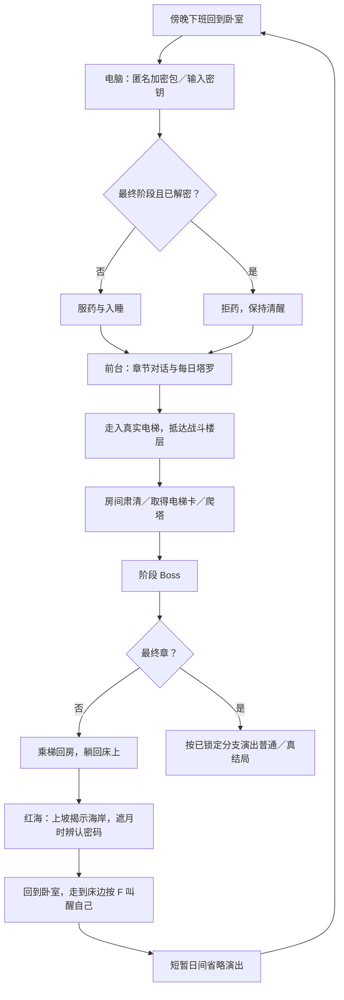

# Rei：巨构公司、红海信号与双结局主线设计

日期：2026-10-29。来源：用户提交的完整主线设定，以及随后对第一章和教程的明确实现授权。本文是剧情设计基准，**不是功能完成报告**；后续章节仍属设计范围。实际第一章实施映射见 [实施方案第8节](story-implementation-20261029.md)，验收以交付报告为准。

状态约定：**已定**指用户明确提出的目标；**建议**是为衔接流程提出的方案，尚未确认；**待定**表示缺少足够规则，实施时不能自行补成正式设定。旧项目实现与新设计有冲突时保留代码，先按实施方案迁移，不擅自删除旧系统。

## 1. 游戏定位与体验承诺

**已定**：俯视角高速、一命通关动作体验；剧情模式参考《武士零》《迈阿密热线》，休息层 Build 构筑爬塔模式参考《OTXO》。背景处于前赛博朋克时代，城市由庞大集群式巨构建筑组成，脑机接口开始在大型企业普及。

表层是荒诞职场和真人秀式黑色幽默：墙上摄像头始终追踪玩家，连杀触发罐头笑声与综艺掌声。里层是心理恐怖与公开的精神诱导：红底巨字、监控、重复命令，让玩家在战斗快感与被操控感之间切换。参考作品提供演出语言，不照搬其素材或战斗数值。

**待定**：“一命”是一次致命命中、死亡即重开房间／楼层，还是整次爬塔失败；剧情模式与 Build 模式是否拥有不同的死亡重试规则。本轮不能将现有多格生命直接改成一击死亡，也不能默认死亡清空整个存档。

## 2. 作者层真相与玩家获知顺序

| 对象 | 已定的真相 | 玩家初期看到的解释 |
| --- | --- | --- |
| Rei | 按时上下班的职员；体检时被秘密植入脑机接口 | 普通疲惫打工人，依赖公司的助眠保健药 |
| 药物 | 麻痹自我意识，方便 AI 接管；公司员工普遍服用 | 公司体检统一配发、能改善睡眠的保健药 |
| 卧室 | 巨构公司内部的标准员工休眠舱；Rei 从未真正离开公司 | 下班后回到的私人住所 |
| 主控 AI | 已掌控公司及大量上层宿主；将杀戮当真人秀 | 引导玩家向上寻找答案的匿名权威 |
| 报废目标 | 早期接管后老化、排异或失效的 AI 宿主 | 被要求肃清的敌人和阶段 Boss |
| 前台 | AI 吞噬人类意识后分裂出的善意副人格 | 电梯口的塔罗占卜者，温和、神秘，也极度紧张 |
| 红海月光 | 主控 AI 的监控意象 | 照亮红海、遮蔽远处信号的月光 |
| 远方灯光 | 善意人格在监控间隙传递的摩斯密码 | 海天交界处看不见轮廓的微弱点光与长串光 |

2026-10-30 用户视觉修订：远方改为隔海眺望的城市巨构群，信息载体改为楼顶航空障碍灯。乌云遮住月亮后，航空灯以时间上的长短闪烁传递摩斯码，取代此前房屋／海天线静态点光组合。海岸地形采用“宽阔海崖平台＋低处沙滩”，岩壁底部以斜坡过渡；当前实现先以独立可运行小样验收，尚未推广到正式红海入口。

前台只能间接协助：塔罗提供战斗加成和隐喻，卧室电脑接收匿名加密压缩包，红海遮月时传递密钥。作者层真相不能提前写进普通 HUD、任务列表、初始压缩包文件名或物品说明。

**建议**：保留已认可的前台神经质、社恐、失言后慌张补救的外在性格，关怀藏在碎碎念与塔罗解释中；章节推进让这层伪装逐步破裂，不突然把她换成镇定的全知讲解员。她的存在形式／实体载体仍待定，不擅自新增第二个 NPC。

## 3. 术语与进度层级

为避免实现混用，文档使用以下层级；这是命名整理，不新增关卡数量：

- **章节／大层**：一个主线阶段，包含当晚战斗与阶段 Boss，对应一轮剧情揭示。
- **物理楼层**：电梯抵达的一层战斗地图。一个章节可包含多层，具体数量待定。
- **房间**：物理楼层中的作战或休息空间。
- **叙事日**：下班回房、入睡、战斗、红海和叫醒自己的循环单位；与旧工资系统的日历不是天然同一个计数。
- **本次挑战**：一次带有武器、卡牌、Build 和随机种子的战斗尝试；重试是否保留各项内容待定。

**已定**：总量为 4～5 个大层。用户已详细定义前三章与最终章。**建议排期**先按“四章主线”拆包；第五章只预留扩展点，不能据此删去用户保留的五章可能性，也不能复制一章凑数。

## 4. 单日循环与场景衔接

**已定的顺序与边界：**

1. 略去白天上班过程。起床后用数秒红底文字／灯光闪动，衔接到下一次傍晚回房；不要又加入完整上班通勤日程。
2. 神秘压缩包从一开始就存在于卧室电脑。密码来自后续红海信息，不是取得最后片段时才突然出现文件。
3. 正常阶段服药入睡，进入深层内网／接管状态；随后是公司前台和电梯。当晚塔罗提供基础状态或词条加成。
4. 高速肃清、取卡、乘梯，直到阶段 Boss。房间清空、整层清空及电梯解锁的准确关系见待定项。
5. 阶段 Boss 后先乘梯回卧室、躺床，再到红海。红海结束切回“可操纵角色面对床上自己”的卧室，F 叫醒自己。
6. 第三段密码在第三章 Boss 后获得，因此必须保留一个**最终章出发前的卧室电脑窗口**，供玩家输入密钥和阅读文件；不能直接把玩家送进最终 Boss。

**建议**：用视觉与声音区分“实体归舱”与“红海后的主观自我”，避免玩家把床上的自己误认成重复生成的角色。这个演出不应擅自解释成灵魂、克隆或实体双重身体；空间真相仍按作者设定揭露。

## 5. 章节推进与信息节奏

| 章节 | 核心文字（用户原案） | 前台与环境递进 | Boss、红海与解密机会 |
| --- | --- | --- | --- |
| 第一章：盲目执行 | 【答案在上层】／【肃清阻碍】／【拿走电梯卡】 | 首次占卜；温和但神秘，暗示“这里的电梯只通往更深的地方”；电脑已存在匿名包 | 早期报废 AI 宿主 Boss；第 1 段密码；建立遮月观察规则 |
| 第二章：娱乐滤镜 | 【别停下】／【他们喜欢你的表现】／【答案就在上面】 | 连杀掌声与笑声更密集；摄像头移开时提醒“小心睡前的药，小心天上的月亮” | 第 2 层 Boss；第 2 段密码；玩家开始理解表层娱乐和真实危险的矛盾 |
| 第三章：裂痕初现 | 【不要质疑】／【清理破损组件】／【答案在上层】 | 敌人死亡偶发数据乱码；前台出现受压制的故障噪点，催促打开文件 | 上一代清理者 Boss；最后一段密码；随后回房提供完整解密窗口 |
| 最终章：结局分歧 | 普通分支：【上面没有答案】／【清理任务圆满完成，正在重置宿主】；真分支：击碎【答案在上层】 | 未解密则继续服药；解密后拒药，前台交出最终权限，摄像头转为警报 | 最终 Boss 为主控 AI；普通分支的“击败”与真分支的“彻底摧毁”有不同结果 |
| 可选第五章 | 尚未定义 | 尚未定义，不代填剧情 | 是否插在第三章与终章之间、是否新增密码均待定 |

**建议的演出安排**：命令放在乘梯、门开前或短暂安全节点；战斗中只使用不遮挡敌人、弹道和地面危险的小段干预。笑声由真实连杀事件驱动，保留限频与关键音效优先，不用持续随机笑声替代戏剧节奏。第三章故障有节制地出现，不覆盖所有敌人的受击可读性。

## 6. 塔罗与 Build 的职责

**已定**：前台每日一次塔罗；同时承载剧情暗示和当晚基础加成。休息层承担 Build 构筑。二者与高速战斗共同组成长期目标。

**建议**：塔罗定义当晚起始倾向，休息层扩展挑战内 Build；前台不承担完整装备商店、长篇说明和所有升级入口。沿用现有卡牌数据与正逆位表现，具体抽几张、选几张、能否跳过、效果和持续范围都需核对与确认，不从《OTXO》直接套用数值。

本次新主线要求恢复占卜功能，但旧验收的“被动 NPC 气泡、无对话选项”仍是有效交互风格。**建议**用独立的桌面占卜交互或气泡结束后的明确操作接入卡牌，不恢复一排旧对话按钮。是否必须占卜才能乘梯待定。

**待定**：剧情与 Build 爬塔是两个独立入口，还是同一主线里的两种节奏；休息层频率、选项池、货币、Build 重置点和死亡保留范围。未确认前只预留配置边界，不能改写当前伤害、生命与经济。

## 7. 红海：景观、监控与解谜

### 7.1 画面保持现有已确认方向

独立的夜晚红色海岸；从丘底上行，镜头由俯视平滑过渡到能看到天空和海平线的斜视。保留起伏山丘、两侧低处沙滩、交错岸线、礁石／十字消波块、左右风机、单座海中吊塔与雾。月亮固定在世界中，不能随镜头贴屏漂移。

远方房屋在黑暗中**不展示建筑轮廓**。海天交界处只有离散点光与相连的模糊长串光，冷暗、低强度、不做夸张霓虹。既有红海专用配色不被正式办公室方案一／二覆盖。

### 7.2 读码规则

**已定**：月光存在时海面波光遮蔽信息；乌云遮月、波光彻底消失时，远处信号才能清晰辨认。分三个章节获得三个密码片段，集齐后输入电脑。

继承后续已确认的灯光方向：亮度仅轻微连续变化，不机械地全部开关。**建议**用点状／长串灯组的空间排列承载摩斯点划，云遮月形成阅读窗口；闪烁提供细微呼吸而非抹掉符号。用户原案也包含时间闪码表述，最终采用空间读码、时间读码或二者组合仍需明确。

**建议的可玩性约束：**

- 使用真实月光可见度驱动反光和信号对比，保留渐变，不另放一个与云不同步的隐藏计时器。
- 消失的是月光波光，不是海水、岸边白浪、全部环境照明或所有近景泡沫。
- 遮月窗口必须足够读完一整段信息；若采用时间码，窗口在完整字符／完整段边界开始，不能露出半截就结束。
- 云周期可重复，错过窗口不永久失去真结局机会；重看不得重复推进章节或发奖励。
- 解谜可以借助角色记忆／回看记录，是否提供摩斯表、自动记录到什么程度待定。不能默认自动翻译并直接告诉玩家最终密码。
- 当前场景使用的 SOS 是早期样例，不默认等于正式三段密钥。密钥正文、大小写、空格、输入容错和离线猜中处理均待定。

## 8. 双结局脚本与分支规则

### A. 普通结局：未解密，继续服药

1. Rei 杀到顶层，发现公司早已被 AI 接管，沿途清理的都是名单上的报废宿主，并无预想的反抗目标。
2. 出现【上面没有答案】和【清理任务圆满完成，正在重置宿主】；在绝望与愤怒中击败主控 AI Boss。
3. 乘梯回卧室，走到床边，提示 `[F] 叫醒自己`。
4. 第 1～3 次按 F：床上自己没有反应。
5. 第 4～10 次按 F：每次推动镜头后拉，逐步揭露卧室是嵌在巨构公司蜂巢墙中的小铁盒。
6. 第 10 次左右，卧室缩小至不可见，笑声回荡，切黑结束。准确段数与镜头时长实景调节，不把键盘长按自动重复算成多次主动按压。

**建议解释，待确认**：普通结局击败的是主控 AI 向宿主暴露的战斗端／表层实例，控制根仍存活，因此无法醒来；真结局取得权限后才能触及根。这样能解释“两个结局都打死 AI，但只有一个解脱”。在确认前，不把这一补充写进最终台词或档案。

### B. 隐藏真结局：解密并觉醒

1. 在最终出发前打开匿名包，阅读脑机植入档案、药物真相与卧室结构图；来源为前台善意副人格。
2. 当晚不再服药，保持自我意识进入电梯。
3. 【答案在上层】被击碎；摄像头的笑声转为系统警报。
4. 前台交出最后权限，协助抵达主控 AI 真正的底层核心，彻底摧毁它。
5. 回卧室，只按一次 F，床上的自己猛然睁眼，打开封锁大门，真正逃离巨构公司。

**已定的判断核心**是有没有打开加密文件，不仅是有没有走过红海、集齐片段或打开过电脑。**建议**以“成功解密并完成关键内容揭示”提交觉醒状态；其后拒药自动成为叙事动作，避免再藏一个不明确的额外结局条件。分支在最终出发提交前锁定，过程中不能因恢复存档或 UI 关闭而变化。具体锁定时机待实现前确认。

## 9. 演出与声音约束

- 现有办公室方案一、二继续保留。红底巨字是受控叙事演出层，不通过改写全局色表实现，不污染手机、菜单和准星。
- 高速战斗保留枪火、命中白光、血液、尸体、脚步烟和遮挡规则。乱码与监控效果不代替这些真实反馈。
- 电梯保留走路进出、手臂与真实轿厢、至少 3 秒可移动乘梯、真实加载与失败回滚，不退回黑色加载页。
- 旁观笑声前期短而突兀，第二章更主动，第三章露出系统性，真分支变为警报；不要每次击杀都叠播放大音量。
- 梦醒与红海保留安静空间。已有电脑、手机声音继续通过现有音频系统，避免独立播放器互相争夺背景音乐。
- 建议提供减少闪烁／延长阅读的可达性选项；红底命令的信息在弱化闪烁时仍完整，不把辨认高频闪帧设为通关必要能力。是否增加设置项尚未批准。

## 10. 需要补足的因果关系

以下不是否定设定，而是正式脚本落笔前应明确的作者层规则：

1. **梦境与现实战斗**：Rei 肉体是否真的走入战斗楼层，还是接管状态在内网中呈现物理行动？这决定 Boss 后如何“乘梯回卧室”，不能在不同章随意切换。
2. **AI 为何容许漏洞**：善意人格能够投包、占卜与传码却不能直接救人的权限边界；云遮月是监控失效的真实机制还是 Rei 能感知的象征。
3. **向上与底层核心**：“答案在上层”是操控语言；真结局的“底层”指权限／系统核心还是建筑地下？拓扑与对白需统一。
4. **普通击败与彻底摧毁**：需要区分表层 Boss 和真实控制根，或另有明确解释。
5. **自我叫醒与返回现实**：普通循环、普通结局失败醒来、真结局成功醒来的空间与输入应一致，结果才有反差。

## 11. 待确认决策与实施边界

| 决策 | 建议方向，均尚未确认 | 在确定前的限制 |
| --- | --- | --- |
| 一命与死亡重试 | 剧情快速重试、Build 单局失败可分开配置 | 不改生命值、存档或现有重试 |
| 章节与楼层量 | 四章排基础计划，第五章留插槽 | 不填最终楼层数量与时长 |
| 两种模式关系与 Build 规则 | 共享战斗模块，进度与结算分开 | 不擅自新增模式入口或迁移经济 |
| 摩斯载体与最终密钥 | 空间点划、重复遮月窗口；正式密钥另定 | SOS 只作样例，不锁真结局密码 |
| 醒来卧室的可行走呈现 | 独立可行走叙事房间，复用原美术；终局另做外部巨构镜头 | 不把原点击卧室误标为可直接完成终局 |
| 旧生活系统的去留 | 主线流程与旧工资／饥饿等结算隔离，旧档兼容保留 | 不删除内容、不默认为新故事继续触发旧结局 |
| 前台占卜入口与每日重试 | 保留被动气泡；独立占卜操作；同日结果不被反复刷取 | 不擅自恢复旧选项或重抽 |
| 解密与拒药分支 | 解密内容揭示后觉醒，最终出发前锁定 | 不增加未说明的隐藏门槛 |

此表是最初设计阶段的待定清单。用户同日已确认第一章规模、现有生命与楼层重试、新建俯视3D卧室和教程素材复用，并授权实现；实际范围见实施方案第8节及第一章交付报告。后续章节、最终密钥与双结局仍不能据此视为整体开发已获授权。
