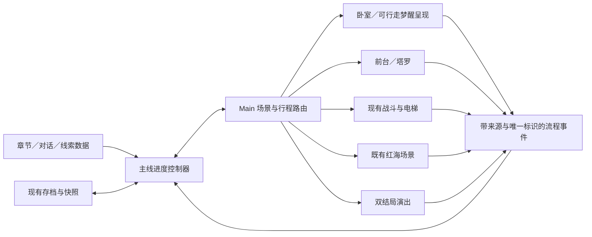

# 新主线实施方案：从现有工程到第一章闭环

日期：2026-10-29。配套 [剧情设计基准](story-design-20261029.md)。**用户同日已追加第一章与教程的实现授权，实际映射见第8节，验收见交付报告。** 第1～7节保留最初文档阶段的建议及调查历史，不能把候选文件名当成当前API。

最初文档阶段由 Codex 独立完成源码调查与设计；工程 `E:\GameProjects\FiveMinuteMore`，分支 `wip/linux-migrate-20261018`，基线 HEAD `b5d286d8491701ac433826aa26b1d75d32f88c75`。后续开发在该工作树进行，保留原有未提交的画面层次增强与测试修改；没有提交或部署。

## 1. 当前工程可复用项与真实缺口

以下为本轮源码检查，不等于逐项运行验收。

| 目标 | 当前证据 | 实施判断 |
| --- | --- | --- |
| 卧室→入睡→前台→正式楼层 | `scripts/app/main.gd` 的 `_show_bedroom`、`_start_story_dream`、`_show_reception`、`_show_dream` | 复用 Main 路由与电梯行程，不再另建平行主入口 |
| 日间跳过与下一天 | Main 的 `_start_new_day` 及既有日历字段 | 可复用场景入口；需要新叙事阶段，不能只把 `calendar_day_id` 当章节 |
| 旧结算与旧结局 | `run_settlement.gd` 按起床时间计算出勤、工资、压力，并能触发正常生活结局；Main 有饥饿结局 | 新主线与旧逻辑有冲突，必须先定义模式／版本边界，不能直接串上旧 `_show_results` 就算完成 |
| 卧室电脑 | `computer_overlay.gd`、电脑场景、`computer.json`；已有记事本、浏览器与 21 点应用接入 | 复用桌面窗口和输入阻断；未在该入口发现正式加密包、密钥验证和三段线索流程 |
| 服药 | `bedroom.gd`、药瓶交互、`melatonin_count`／`night_state` | 复用原演出；药物真相属于叙事重定义，不能顺带改库存、药效或经济 |
| 走到床边 F 叫醒自己 | 卧室目前以鼠标命中区域交互，床上角色为 Sprite | 需要可行走的叙事呈现与床边交互，尚不是现成动作；终局后拉还需要外部巨构场景 |
| 前台对话与塔罗 | `dream_3d_reception_room.gd`、被动 NPC、气泡、TarotOverlay、TarotDrawController | 对话与卡牌可复用，但当前完成气泡不自动抽牌；新入口与每日次数要显式接入 |
| 电梯与多层生成 | `dream_3d_random_dungeon.gd`、`reception_elevator_journey.gd`、已有楼层门与轿厢 | 保留现有动画、真实加载、最低乘梯时长与失败恢复；增加章节目标，不重写生成器 |
| 房间清空与电梯卡 | `_on_enemy_defeated`、`mark_room_cleared`、`collect_employee_badge`；已有 `floor_index` 与 `dream_layer_id` | 现有楼层通行与 Boss 门钥匙是不同状态；新方案要明确整层肃清与持卡的组合条件，不能只改提示文字 |
| Boss | 现有 Boss 候选房、`boss_enemy`／`boss_defeated`、Boss 死亡回调 | 有战斗挂接点；不能据此宣称已有三位剧情 Boss、上一代清理者或主控 AI 行为／美术 |
| 死亡重试 | `dream_3d_run_interface.gd` 调用 `restart_current_floor_after_death`，现有配置保留多格生命 | 与“一命”定义需统一，获确认前不更改 |
| 连杀笑声与掌声 | `record_kill` 调用 `SFXManager.trigger_multi_kill_reaction` | 复用现有触发，补章节节奏；不另起一套连杀计数 |
| 追踪摄像头与命令演出 | 现有战斗目录抽查未定位到覆盖全楼层的主线监控系统 | 视为待建设；不能把游戏 Camera 当墙上监控道具 |
| 红海 | `scenes/preview/night_coast.tscn` 及 display 包装；`night_coast.gd`／`coast_atmosphere.gd` | 已有场景与空间 SOS 灯组、轻微亮度变化、月光可见度；仍是独立入口，需剧情驱动、片段数据与正式退出契约 |
| 存档与回滚 | `game_save_store.gd`、`day_start_snapshot.gd` | 复用存储和快照，不直接复制另一份剧情存档；新增状态需处理旧档默认值与快照覆盖 |

电脑旧文案含“1999 年”；新设定没有钉死公历年。它是否保留为架空年份或改写，列为内容核对，不能默认为既定世界年代。

## 2. 总体架构与职责

**建议**采用一个主线进度控制器配数据化章节。Main 保持场景所有者；战斗、电脑、前台与红海只上报自己的结果，不分别推动章节。

必须保留现有 `dream_player.gd` 的 2D 战斗权威和被动 3D 深度显示桥；不恢复退役的旧 2D Dream，不新建第二套战斗模拟。不要把剧情控制继续塞入大型生成器的每个生成分支。

建议的新模块边界：

| 模块／候选位置（尚未创建） | 职责 | 不负责 |
| --- | --- | --- |
| `scripts/story/story_progression.gd` | 阶段合法性、章节进入与完成、觉醒／结局判定、幂等提交 | 直接绘制 UI、移动角色、生成战斗地图 |
| `data/story/chapters.json` 及相应加载入口 | 顺序、楼层角色、Boss ID、对话 ID、密码片段 ID、命令事件 ID | 保存玩家进度或将敌人数量写死在剧情里 |
| `scripts/story/story_save_adapter.gd` 或现有存档的窄适配层 | 新旧数据迁移、持久与挑战内状态分离、快照同步 | 另存第二套相互冲突的存档 |
| `scripts/story/story_presentation.gd` | 安全节点的红底命令、章节节奏、笑声／警报请求 | 自行解锁结局或更改色表 |
| 电脑加密包应用 | 输入、错误反馈、档案展示，上报验证结果 | 直接增加章节或改药物状态 |
| 红海剧情适配层 | 设置本章信号、观察窗口、进出场与完成事件 | 重做已认可海浪或把全海面改成静态贴图 |
| 梦醒／终局场景控制器 | 走向床边、F 主动按压、镜头揭露和完成反馈 | 直接发工资、清空全局存档 |

是否需要单独文件由未来实际实现决定；禁止为了符合表格新建只有转发作用的空模块。

## 3. 进度与数据契约草案

### 3.1 状态分层

| 生命周期 | 建议记录 | 回滚与保存原则 |
| --- | --- | --- |
| 剧情持久 | 故事版本、模式、当前章节、循环阶段、已完成章节、已获／已观察线索 ID、文件是否解密／揭示、已锁结局路线、已解锁结局 | 不因死亡或关闭手机丢失；按约定提交点保存，不能被旧日初快照整份覆盖 |
| 叙事日／本章尝试 | 当日服药状态、占卜次数与结果、章节引导是否播过、当前挑战标识 | 重试是否重置需按确认后的规则配置；防止重读档无限刷卡 |
| 挑战内 | 现有物理楼层索引、种子、房间状态、卡片／Build、敌人、血迹与临时特效 | 复用现有挑战权威；不全部写进剧情永久数据 |
| 仅呈现 | 红海云位置、镜头插值、按键短动画、字幕展开进度 | 可恢复到安全锚点，不作为剧情解锁的唯一依据 |

建议阶段枚举：`EVENING` → `SLEEP` → `RECEPTION` → `ASCENT` → `BOSS_RETURN` → `COAST` → `SELF_WAKE` → 下一叙事日。最终出发分流到 `FINAL_NORMAL` 或 `FINAL_AWAKENED`，完成后进入 `ENDING_COMPLETE`。`SLEEP` 在觉醒路线表示入睡／接入仪式，不意味着仍然服药；具体无药进入方式需作者确认。

事件示例（建议，不是已有接口）：`tarot_committed`、`chapter_boss_defeated`、`coast_segment_observed`、`archive_unlocked`、`archive_revealed`、`departure_committed`、`self_wake_completed`、`ending_completed`。每项携带所属故事版本、章节、挑战或行程标识；验证来源与当前阶段后再提交。

### 3.2 关键不变量

1. 章节 ID、物理 `floor_index`、旧 `dream_layer_id` 与日历分别存储并显式映射；不能用一次换层或一次 `calendar_day_id += 1` 自动推进故事。
2. 只有合法阶段的目标 Boss 死亡提交本章完成；普通敌人、旧 Boss 门钥匙和电梯卡不能冒充章节完成。
3. 同一事件重复发出、读档重放或对话反复交互只提交一次。奖励、线索、占卜次数和日推进都必须幂等。
4. 密钥错误、关闭档案窗口、退出手机不重置已获线索，也不触发觉醒。真结局不能只检查“到过红海”。
5. 第三章结束后保留卧室解密机会；最终出发锁定分支，锁定后不能被迟到的异步信号改写。
6. 失败回滚保留明确的持久剧情成果；挑战内物品按已确认规则恢复，不通过深复制全部运行状态碰运气。
7. 日推进只在 `self_wake_completed` 事务成功后发生一次；红海退出和回房本身不能各推进一天。
8. 旧生活模式、独立预览或未来 Build 模式不能误触发主线解密／结局。调试跳章必须可区分，不伪装成正式通关证据。

### 3.3 中断与旧档

复用现有存档入口，加入版本化默认值与迁移。建议旧档继续保留旧生活进度，新增主线作为明确的新流程启动；是否允许转换旧档待确认。绝不把旧“正常生活结局”自动映射为本次普通结局。

在 Boss 完成、取得信号、成功揭示档案、最终出发及叫醒完成处使用明确提交点。恢复时从安全锚点继续：不能半段强制镜头中途变成可开火，也不能重复发放塔罗效果。写盘失败不得先销毁当前可恢复场景；换层失败沿用已有真实轿厢回滚，保留操作权。

普通结局的 F 次数是否跨退出恢复待定；无论采用哪种规则都应明确恢复到床边开始或已提交镜头节点，不能在重播笑声时累计到下一次按压。

## 4. 旧系统迁移边界

| 当前行为 | 与新主线的冲突 | 建议迁移策略，尚未实施 |
| --- | --- | --- |
| 起床时间→出勤、工资、压力、正常生活结局 | 新主线跳过工作日，并指定新的双结局 | 按模式隔离结算，不让故事章节终结进入旧生活结局；保留旧模块与存档字段 |
| 饥饿可直接触发结局 | 新章节密码收集可能被旧规则截断 | 确认旧生活系统保留范围；不先删除购买、配送或食物 |
| 当前剧情进度混合日历、梦境层数 | 不能表达多物理楼层的一章和 Boss 后红海 | 增加独立故事进度，显式适配现有字段 |
| 被动前台暂不抽牌 | 新设计需要每日占卜 | 保留气泡与无选项风格，新增确定的占卜操作与次数提交 |
| 点选卧室与床上角色 | 新要求可走到床边，看自己并逐次后拉 | 新增叙事动作呈现，不假称原卧室已可自由行走；原电脑／手机功能保留 |
| 独立海岸调试输入、注水与状态文字 | 正式剧情不应出现实验工具或绕过阶段的快捷键 | 用正式场景模式控制，只关闭调试入口；保留独立预览供编辑验证 |
| SOS 空间灯组 | 正式三段密钥尚未定义 | 将信号内容数据化，保留海天线模糊点／长串外观与轻微连续亮度变化 |
| 多格生命、当前楼层重试 | “一命”尚未精确定义 | 只记录差异；待决定后配置，不在剧情接入时偷偷调平衡 |

## 5. 分阶段任务与交付门槛

每阶段一个完整任务契约，开始前明确唯一写入者和实际文件所有权；执行按 AGENTS 默认调度或用户最新指定。关键设计由 Codex集中验收。下表不预先锁定不可验证的 Agent／模型。最多两轮自主修复，重大存档／权限／共享文件冲突提前报告。无明确启动不派发开发。

### P0：确定第一章闭环边界

目标：确认一命／重试、两种模式关系、密码呈现、卧室可行走表现，以及旧结算如何隔离。先确认影响闭环的项目，最终楼层量、最终密钥与完整 Boss 数值可后续补齐。

允许修改：设计文档；不改场景、脚本、生命、伤害、存档或经济。验收是确认／待定标记清楚，第一章每个入口和出口都有负责人。交付更新本文与剧情设计；不以问卷覆盖全部后期细节。

### P1：故事状态、章节数据与存档迁移

依赖 P0。目标：构建可独立验证的进度规则和旧流程隔离。

计划范围：新的故事控制与数据；窄改 `main.gd`、`game_save_store.gd`、`day_start_snapshot.gd` 的接入点。公共接口：章节目标查询、合法事件提交、恢复安全阶段。禁止改生成算法、玩家战斗与画面着色器。

验收：重复事件不重复推进；退出／继续停在正确阶段；缺少新字段的旧档能读；未知版本不静默覆盖原档；未解密不能真结局；旧饥饿／正常生活结局不会串入新主线。使用正常 SceneTree 注册 Autoload 后运行状态测试与资源加载，不把缺少 Autoload 的单脚本检查当工程编译结果。

### P2：卧室、前台与第一章战斗路由

依赖 P1。目标：从正式 Main 进入新叙事日，看见初始匿名包、服药、前台对话和每日塔罗，经真实轿厢进入章节目标楼层。

计划范围：`bedroom.gd`、电脑应用、`dream_3d_reception_room.gd`、章节对话数据；Main 接入窄改由同一写入者整合。沿用现有卡牌目录与物理电梯。确认的章节接口接入 `dream_3d_random_dungeon.gd`／run_interface，禁止将整个生成器重做。

验收：气泡与占卜输入无冲突；退出／重入不重复发卡；过场期间 Tab／Esc 不泄漏战斗输入；真实走入电梯且至少 3 秒可移动轿厢；卡、清场、Boss 目标分别可验证；普通换层不误结束本章。第一章可用明确标注的剧情 Boss 占位，不冒充已完成独立 Boss 行为与美术。

### P3：Boss 后回房→红海→叫醒自己

依赖 P2。目标：打通首个完整剧情闭环，作为第一轮可玩小样。

计划范围：红海正式模式与本章信号适配、Boss 返程路由、可行走的梦醒卧室、F 床边交互与安全恢复。复用现有红海布局和水系统；禁改已认可浪形、风机／吊塔数量和配色来掩盖流程问题。

验收：目标 Boss 仅完成一次；先返卧室躺床再到红海；上坡时镜头真实揭示海岸；云遮月与波光消失、信号可读同步；白浪和红海仍在；错过可重看；从红海回房后能真实走到床边按 F；只推进一次叙事日。中途退出后能从约定锚点继续，不丢线索。

交付：正式 Main 完整入口的正常速度分段录像／动图、遮月前后截图、回房 F 操作、存档复现步骤及检查记录。脚本跳 Boss 可用于分支覆盖，但必须标注；验收录像至少有一条按正式玩法到达的完整路线。用户认可闭环后再制作其余章节。

### P4：监控／命令／后三章与 Build

依赖已认可的 P3；Build 依赖模式与重置规则另行确认。目标：按章节提升黑色幽默到心理压迫，补第二、三章 Boss 和最后密码片段。

计划范围：章节数据、监控道具与演出控制、连杀音频编排、休息层策略。地图、怪物数量及战斗规则只有明确任务才可调整。相对独立的监控美术与章节数据可分工；共享 Main 和故事状态只设一个写入者。

验收：摄像头朝玩家且服从墙体裁切／真实遮挡；不为每台摄像头新增第二套游戏视口；命令不遮挡作战危险；音频不叠爆、不覆盖重要反馈；暂停／换层清理无悬挂计时器；前三段信息可重看；第三章后保留解密窗口；Build 与剧情进度互不串档。

### P5：完整解密与双结局

依赖 P4 和作者层因果规则确认。目标：制作真实／表层 AI 战斗差异、权限交接、普通结局多次 F 后拉与真结局一次 F 醒来出逃。

计划范围：加密包正式档案、最终分支、终局场景、Boss 独立内容和结局记录。前台仍只有原 NPC；不依赖删除原卧室或战斗层达到镜头揭露。

验收：三段线索、密码验证和档案揭示语义一致；输入错误／退出不锁死；未解密与已觉醒各有完整正式入口录像；普通分支 1～3 次无反应、4～10 次连续退远，长按不连计；真分支一次有效 F 睁眼并出门；最终镜头由真实场景构图完成，不用缩放静态卧室截图冒充外部巨构；重看结局不重复结算。

## 6. 验收矩阵与测量边界

| 类别 | 必须覆盖 | 证据 |
| --- | --- | --- |
| 流程 | 新档第一章、三章收集、最终出发、两个结局 | 状态事件轨迹＋正式 Main 可玩录像 |
| 重复操作 | 重复死亡信号、连续按 E／F、退出对话、重复打开文件、手机与场景交互冲突 | 自动断言＋实际输入检查 |
| 存档 | 每个提交点退出／继续、旧档、缺字段、写入失败、章节与日历分离 | 隔离用户目录中的前后存档对照，保留原档 |
| 电梯 | 首次进入、普通换层、Boss 返程、加载失败恢复 | 实际轿厢 Camera 与恢复操作记录 |
| 解谜 | 月光存在／完全遮月／恢复、错过窗口、不同镜头位置、完整片段 | 正常速度录像；若慢放必须标注；不能只验参数 |
| 美术 | 两套办公室色表、红海独立色、角色层级、床上自己、外部蜂巢揭露 | 实际游戏 Camera 截图与动态路线 |
| 声音 | 连杀限频、章节变化、警报取代笑声、梦境与卧室静音边界 | 可听音轨的录像；静音测试不能证明听感 |
| 性能 | 最密集战斗＋监控、命令出现、红海云与浪、换层与恢复 | 硬件／分辨率／负载／预热／样本范围；完整帧及峰值，不用冻结 draw span 宣称 60 FPS |

后台隐藏／最小化运行，GPU 用例串行，不关闭用户软件来换取成绩。日志区分脚本／着色器错误、断言失败、既有锚点警告与退出资源诊断。每阶段提供实际参与者、变更文件、测试命令／退出码／计数、修复轮数、未解决项和证据目录。

## 7. 本轮文档交付检查

本轮只新增两份方案文档，并在 `docs/ai/PROJECT_CONTEXT.md` 加入日期化索引。运行时代码、场景、素材、存档和已有配色实现未修改。完成相对链接、阶段依赖、所有待定标记及工作树差异检查；没有运行游戏或声称新剧情已可玩。

下一步建议是 P0 的必要决策确认，然后由用户明确启动 P1～P3 的第一章闭环小样。当前不派发实现任务。

## 8. 同日后续授权与实现映射

以上第7节为最初文档阶段的历史记录。用户随后已确认并启动第一章、重做教程与新增美术，指定Codex当前会话直接开发。第一章范围收束为两层正式办公室、一个安全构筑层、一个宿主Boss层；继续沿用现有生命值和当前楼层重试。新建独立俯视3D卧室，教程直接拼贴本工程已批准的房间家具和墙地；不把角色贴在旧2D卧室图上。

| 实际文件 | 本轮职责 |
| --- | --- |
| scripts/story/chapter_one_state.gd | 版本化第一章阶段、楼层角色、占卜／Build／线索与完成事件幂等检查 |
| scripts/story/chapter_one.gd | Main路由、现有存档提交、恢复锚点、日历与叫醒一起保存 |
| scenes/story/chapter_bedroom.tscn / chapter_wake_room.gd | 可编辑俯视卧室、真实走动、电脑、原服药UI、躺床与F叫醒 |
| scenes/story/chapter_tutorial_layout.tscn / chapter_tutorial.gd | 准备区、移动区、射击区；观察真实移动、冲刺、交流、拾枪、开火、换弹和击倒 |
| scripts/story/chapter_run.gd / chapter_tarot.gd | 正式办公室目标、一次Build、章节卡片加成、宿主Boss与真实返程轿厢 |
| scripts/story/chapter_coast.gd | 复用原红海，遮月窗口观察第一段S（三个点）、退出与继续恢复 |
| scripts/story/chapter_archive.gd | 首晚已有匿名加密档案；本章无法解密，不提前展示后续真相 |
| art/story/chapter1 / tools/build_chapter1_pixel_assets.py | 原创逐面32px/m家具、监控与工作台，生成配方与资产审计 |

卡片使用原22张图与抽取结果；原卡目录没有战斗词条实现，本章新增可配置的三种基础收益：伤害+10%、攻速+10%、射程+32，反位改变映射；不把新增收益描述为旧系统已存在。休息层三选一：伤害+15%、攻速+15%、射程+64，不叠加重复提交。Boss复用原尺寸员工Boss原画与行为，半血切步枪并留出1.25秒准备，不宣称新Boss原画已完成。

新卧室的第一章购物保持只读，明确显示“本章暂不开放购物”，避免尚未迁移的外卖配送收款后无法领取；原生活卧室的购物与配送保留。聊天、音乐、设置与Tab手机可用。章末仅开放已完成的第一章边界，不发起第二章。

本次自动路线使用真实输入、枪械子弹、伤害、拾卡、升级与电梯；为控制导航耗时会定位角色到房间／交互点，并在测试中给予免伤，不等同人工一命通关或难度平衡验收。音频采用Dummy驱动，不能证明最终听感。正式结果、命令、画面与剩余限制记录在交付报告，不以本计划代替验收。
